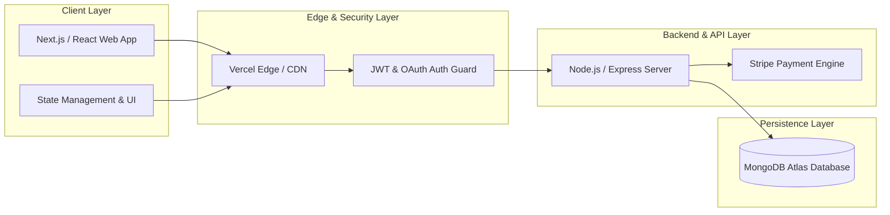

<!-- ═══════════════════════════════════════════════════════════════ -->
<!--                  🚀 NEXT-LEVEL ANIMATED BANNER                -->
<!-- ═══════════════════════════════════════════════════════════════ -->

<p align="center">
  
</p>

<!-- ═══════════════════════════════════════════════════════════════ -->
<!--                  💫 PROFILE HERO & TYPING                     -->
<!-- ═══════════════════════════════════════════════════════════════ -->

<div align="center">

<table>
<tr>
<td align="center" valign="middle" width="160">
  <a href="https://github.com/Farhadmu">
    
  </a>
</td>
<td align="left" valign="middle">

#  Hello, World! I'm MD Farhadul Islam

<p align="left">
  <a href="https://github.com/Farhadmu">
    
  </a>
</p>

<p align="left">
  
  
  
  
</p>

<p align="left">
  <a href="https://www.linkedin.com/in/md-farhadul-islam-025438373/" target="_blank">
    
  </a>
  <a href="https://github.com/Farhadmu" target="_blank">
    
  </a>
  <a href="mailto:mi0223937@gmail.com">
    
  </a>
</p>

</td>
</tr>
</table>

</div>

<!-- ═══════════════════════════════════════════════════════════════ -->
<!--                  ⚡ ANIMATED TECH MARQUEE                     -->
<!-- ═══════════════════════════════════════════════════════════════ -->

<div align="center">

### ⚡ Production Tech Stack & Engineering Tools
<br>

<a href="#-technical-skills--architecture">
  
</a>

</div>

<br>

<p align="center">
  
</p>

<!-- ═══════════════════════════════════════════════════════════════ -->
<!--                  💻 INTERACTIVE ENGINEER TERMINAL             -->
<!-- ═══════════════════════════════════════════════════════════════ -->

## 💻 Engineer Terminal Session

```bash
farhad@garuda-arch:~$ cat farhad_spec.json
{
  "engineer": "MD Farhadul Islam",
  "role": "Software Engineer & Full-Stack Systems Architect",
  "education": "B.Sc. in Computer Science & Engineering (CSE)",
  "specialization": ["High-Performance Full-Stack Web Apps", "MERN & Next.js", "Algorithmic Problem Solving"],
  "architectural_principles": ["Clean Architecture", "SOLID & DRY", "RESTful Conventions", "Database Normalization"],
  "daily_driver_os": "Garuda Linux (Arch-based Kernel)",
  "mindset": "Turn complex algorithmic problems into reliable, scalable, and elegant software systems."
}
farhad@garuda-arch:~$ ./run_tests.sh --all
[✓] Core CS Foundations: Passed (DSA, OOP, Big-O Analysis)
[✓] Backend Services: Passed (Node.js, Express, MongoDB, JWT Auth, Stripe API)
[✓] Frontend Applications: Passed (React, Next.js, Tailwind, Responsive UI)
[✓] System Status: Production Ready 🚀
```

<br>

<!-- ═══════════════════════════════════════════════════════════════ -->
<!--                  👨‍💻 ABOUT ME & CORE VALUES                   -->
<!-- ═══════════════════════════════════════════════════════════════ -->

## 👨‍💻 Engineering Profile & Overview

<table>
<tr>
<td width="55%" valign="top">

I am a **Software Engineer** with a solid foundation in **Computer Science & Engineering (CSE)**. My expertise centers around architecting and deploying end-to-end full-stack systems with **React, Next.js, Node.js, Express, and MongoDB**, paired with strong computational problem-solving abilities in **C++**.

- 🏗️ **Full-Stack Architecture**: Designing clean, decoupled client-server systems with secure authentication, payment workflows, and persistent databases.
- 🧠 **Algorithms & CS Foundations**: Actively applying Data Structures, Graph Theory, and Search Algorithms to write optimized, low-latency code.
- 🔒 **Security-First Approach**: Implementing robust RBAC (Role-Based Access Control), JWT sessions, sanitized database queries, and secure API gateways.
- 🐧 **Linux Power User**: Operating daily in **Garuda Linux**, leveraging command-line tooling, Git version control, and shell scripting for efficient workflows.
- 🎯 **Continuous Engineering**: Striving for production-grade software that scales smoothly under real-world usage.

</td>
<td width="45%" align="center" valign="middle">


</td>
</tr>
</table>

<br>

<!-- ═══════════════════════════════════════════════════════════════ -->
<!--                  📐 SYSTEM ARCHITECTURE DESIGN PATTERN        -->
<!-- ═══════════════════════════════════════════════════════════════ -->

## 📐 Full-Stack System Architecture Blueprint



<br>

<p align="center">
  
</p>

<!-- ═══════════════════════════════════════════════════════════════ -->
<!--                  🛠️ TECHNICAL SKILLS & ARCHITECTURE          -->
<!-- ═══════════════════════════════════════════════════════════════ -->

## 🛠️ Technical Skills & Architectural Layers

<div align="center">

<table>
<tr>
<th width="50%" align="center">🌐 Layer 1: Frontend & Client Systems</th>
<th width="50%" align="center">⚙️ Layer 2: Backend, APIs & Authentication</th>
</tr>
<tr>
<td valign="top">

| Technology | Proficiency | Rating |
|:-----------|:-----------:|:------:|
| **React.js** | `█████████░` | 🟢 90% |
| **Next.js 14** | `████████░░` | 🔵 85% |
| **JavaScript (ES6+)** | `█████████░` | 🟢 92% |
| **Tailwind CSS** | `██████████` | 🟢 95% |
| **HTML5 & Modern CSS3** | `██████████` | 🟢 95% |
| **DaisyUI** | `████████░░` | 🔵 85% |
| **Vite Tooling** | `████████░░` | 🔵 88% |

</td>
<td valign="top">

| Technology | Proficiency | Rating |
|:-----------|:-----------:|:------:|
| **Node.js** | `████████░░` | 🔵 85% |
| **Express.js** | `█████████░` | 🟢 90% |
| **RESTful API Design** | `█████████░` | 🟢 90% |
| **JWT Authentication** | `█████████░` | 🟢 90% |
| **Stripe Checkout & Webhooks**| `████████░░` | 🔵 85% |
| **Firebase Auth & Firestore** | `████████░░` | 🔵 80% |
| **API Rate Limiting & Security**| `████████░░` | 🔵 80% |

</td>
</tr>
<tr>
<th width="50%" align="center">🧠 Layer 3: Algorithms, CS & Languages</th>
<th width="50%" align="center">🗄️ Layer 4: Databases, DevOps & Tooling</th>
</tr>
<tr>
<td valign="top">

| Subject / Language | Proficiency | Rating |
|:-------------------|:-----------:|:------:|
| **C++ (STL, OOP, Templates)**| `█████████░` | 🟢 88% |
| **C Language (Pointers, Memory)**| `████████░░` | 🔵 82% |
| **Data Structures & Algorithms** | `████████░░` | 🔵 85% |
| **Time & Space Complexity** | `█████████░` | 🟢 90% |
| **Competitive Programming** | `████████░░` | 🔵 80% |
| **Object-Oriented Design (OOD)**| `█████████░` | 🟢 88% |

</td>
<td valign="top">

| Database & Tool | Proficiency | Rating |
|:----------------|:-----------:|:------:|
| **MongoDB & Mongoose ORM** | `████████░░` | 🔵 85% |
| **Git & GitHub Workflows** | `██████████` | 🟢 95% |
| **Linux (Garuda / Arch CLI)** | `█████████░` | 🟢 88% |
| **Postman API Testing** | `█████████░` | 🟢 90% |
| **VS Code Power Environment** | `██████████` | 🟢 95% |
| **Vercel & Netlify CI/CD** | `█████████░` | 🟢 92% |

</td>
</tr>
</table>

</div>

<br>

<!-- ═══════════════════════════════════════════════════════════════ -->
<!--                  📚 COMPUTER SCIENCE FOUNDATIONS              -->
<!-- ═══════════════════════════════════════════════════════════════ -->

## 📚 Computer Science & Engineering Foundations

<div align="center">

| Domain | Core Concepts & Production Application |
|:-------|:---------------------------------------|
| **🧠 Data Structures** | Arrays, Linked Lists, Stacks, Queues, Binary Trees, BST, Graphs, Hash Tables, Heaps, Priority Queues |
| **⚡ Algorithmic Paradigms** | Two Pointers, Sliding Window, Binary Search, BFS/DFS Traversal, Greedy Methods, Recursion & Backtracking |
| **🏛️ Software Engineering** | Modular Architecture, Separation of Concerns, DRY, KISS, SOLID Principles, Clean Code Standards |
| **🔢 Discrete Mathematics** | Graph Theory, Combinatorics, Logic Systems, Set Theory, Recurrence Relations |
| **🖥️ Operating Systems** | Process & Thread Concurrency, Memory Management, Linux Shell Scripts, File Systems, System Calls |
| **🌐 Computer Networks** | HTTP/HTTPS Protocols, TCP/IP Model, DNS, REST Conventions, WebSockets, CORS Policies |

</div>

<br>

<p align="center">
  
</p>

<!-- ═══════════════════════════════════════════════════════════════ -->
<!--                  🚀 FEATURED ENGINEERING PROJECTS             -->
<!-- ═══════════════════════════════════════════════════════════════ -->

## 🚀 Featured Engineering Case Studies

<br>

### 🎨 01. ArtHub — Full-Stack Multi-Tenant Art Marketplace & Monetization Engine

> **A scalable, production-grade e-commerce ecosystem connecting digital artists and global collectors.** Features enterprise-level authentication, Stripe checkout & subscription billing, real-time reviews, and multifaceted management dashboards.

<p>
  
  
  
  
  
  
</p>

**System & Engineering Highlights:**
- 🛡️ **Role-Based Access Control (RBAC)**: Engineered a 3-tier user privilege matrix (Customer, Artist, Platform Admin) secured via JWT token verification and Google OAuth 2.0.
- 💳 **Financial Pipeline**: Integrated Stripe Checkout sessions supporting one-off artwork purchases alongside tiered recurring subscriptions (Free, Pro, Premium).
- 🖼️ **High-Performance Catalog**: Optimized artwork browsing using indexed queries, category filters, and fluid pagination.
- 💬 **Gated Interaction Loop**: Developed a purchase-verified comment and review engine with atomic CRUD operations.
- 📊 **Metric Dashboards**: Dedicated operational panels for User orders, Creator inventory/sales tracking, and Administrator platform telemetry.

<p>
  <a href="https://arthub-client-olive.vercel.app/" target="_blank">
    
  </a>
  <a href="https://github.com/Farhadmu/Arthub-client" target="_blank">
    
  </a>
  <a href="https://github.com/Farhadmu/Arthub-server" target="_blank">
    
  </a>
</p>

---

### 🛒 02. DigiTools — Reactive Client-Side E-Commerce Engine

> **A high-speed, client-side digital product storefront featuring instantaneous reactive state management, cart calculation engine, and non-blocking notifications.**

<p>
  
  
  
  
</p>

- ⚡ **Optimized State Machine**: Real-time cart calculations, subtotal, tax handling, and instant counter synchronization without extraneous re-renders.
- 🎯 **Asynchronous Feedback**: Integrated toast alert queues providing clear operational feedback across addition, removal, and checkout states.
- 📱 **Responsive 3-Column Grid**: Engineered responsive breakpoints tailored for seamless performance across mobile, tablet, and wide desktop screens.

<p>
  <a href="https://marvelous-nougat-5c5bf6.netlify.app/" target="_blank">
    
  </a>
  <a href="https://github.com/Farhadmu/DIgiTools-" target="_blank">
    
  </a>
</p>

---

### 🧠 03. KV Knowledge Vault — Modern Second Brain Platform

> **Engineered high-converting, accessible web architecture from Figma design specifications with component modularity and responsive typography.**

<p>
  
  
  
</p>

- 🎨 **Pixel-Perfect Fidelity**: Strict component-based implementation of complex Figma design tokens.
- 📐 **Accessibility & SEO**: Clean semantic HTML structure scoring top Lighthouse marks in Performance and Accessibility.

<p>
  <a href="https://farhadmu.github.io/KV_Knowledge_Vault/" target="_blank">
    
  </a>
  <a href="https://github.com/Farhadmu/KV_Knowledge_Vault" target="_blank">
    
  </a>
</p>

---

<details>
<summary><b>🔍 View Core JavaScript & DOM System Implementations (Click to expand)</b></summary>
<br>

#### 📋 GitHub Issues Tracker Engine
- Applied asynchronous fetch routines, ES6 modules, and error-handling pipelines for real-time repository issue tracking.
- 🔗 [Live Application](https://farhadmu.github.io/B-13-assignment-5/login.html) &nbsp;|&nbsp; 📂 [Source Code](https://github.com/Farhadmu/B-13-assignment-5)

#### 💼 Job Application Tracker Engine
- Event bubbling, DOM delegation, dynamic filtering, and interactive state persistence.
- 🔗 [Live Application](https://farhadmu.github.io/B-13-assignment.A-4/) &nbsp;|&nbsp; 📂 [Source Code](https://github.com/Farhadmu/B-13-assignment.A-4)

</details>

<br>

<p align="center">
  
</p>

<!-- ═══════════════════════════════════════════════════════════════ -->
<!--                  🐍 ANIMATED CONTRIBUTION SNAKE               -->
<!-- ═══════════════════════════════════════════════════════════════ -->

## 🐍 GitHub Contribution Journey

<div align="center">

<p>
  <b>Automated GitHub Contribution Snake Eater &bull; Powered by GitHub Actions CI/CD</b>
</p>

<picture>
  <source media="(prefers-color-scheme: dark)" srcset="https://raw.githubusercontent.com/Farhadmu/Farhadmu/output/github-contribution-grid-snake-dark.svg" />
  <source media="(prefers-color-scheme: light)" srcset="https://raw.githubusercontent.com/Farhadmu/Farhadmu/output/github-contribution-grid-snake.svg" />
  
</picture>

</div>

<br>

<!-- ═══════════════════════════════════════════════════════════════ -->
<!--                  📊 GITHUB LIVE ANALYTICS                     -->
<!-- ═══════════════════════════════════════════════════════════════ -->

## 📊 Live GitHub Engineering Metrics

<div align="center">

<table>
<tr>
<td width="50%" align="center">
  
</td>
<td width="50%" align="center">
  
</td>
</tr>
<tr>
<td colspan="2" align="center">
  <br>
  
</td>
</tr>
<tr>
<td colspan="2" align="center">
  <br>
  
</td>
</tr>
</table>

</div>

<br>

<!-- ═══════════════════════════════════════════════════════════════ -->
<!--                  💡 DAILY DEV INSPIRATION                     -->
<!-- ═══════════════════════════════════════════════════════════════ -->

<div align="center">

### 💡 Software Engineering Philosophy

> *"Simplicity is prerequisite for reliability."* — **Edsger W. Dijkstra**

<br>


</div>

<br>

<p align="center">
  
</p>

<!-- ═══════════════════════════════════════════════════════════════ -->
<!--                  📫 GET IN TOUCH / CONNECT                    -->
<!-- ═══════════════════════════════════════════════════════════════ -->

## 🤝 Let's Connect & Build High-Impact Systems!

<p align="center">
  I am actively seeking <b>Software Engineering</b> opportunities, collaborative open-source initiatives, and high-impact software projects.
</p>

<div align="center">

<a href="https://www.linkedin.com/in/md-farhadul-islam-025438373/" target="_blank">
  
</a>
&nbsp;
<a href="mailto:mi0223937@gmail.com">
  
</a>
&nbsp;
<a href="https://github.com/Farhadmu" target="_blank">
  
</a>

<br><br>

<a href="#-next-level-animated-banner">
  
</a>

</div>

<br>

<!-- ═══════════════════════════════════════════════════════════════ -->
<!--                  🌊 ANIMATED FOOTER WAVE                      -->
<!-- ═══════════════════════════════════════════════════════════════ -->

<p align="center">
  
</p>

<div align="center">

<sub>Engineered with precision & passion by <b>MD Farhadul Islam</b> &bull; &copy; 2026 Software Engineering Portfolio</sub>

</div>
